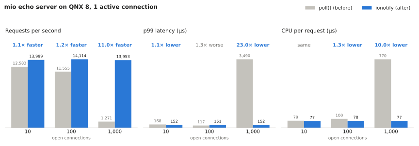
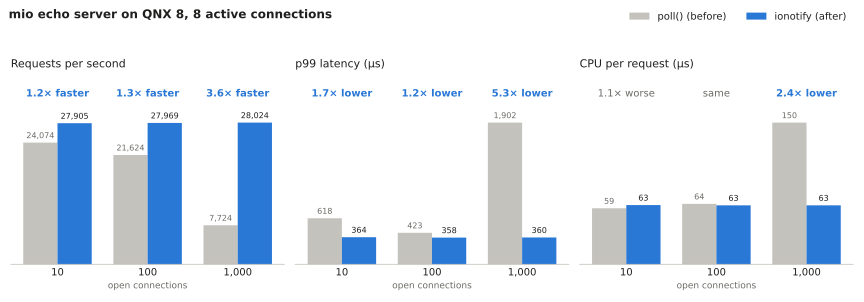
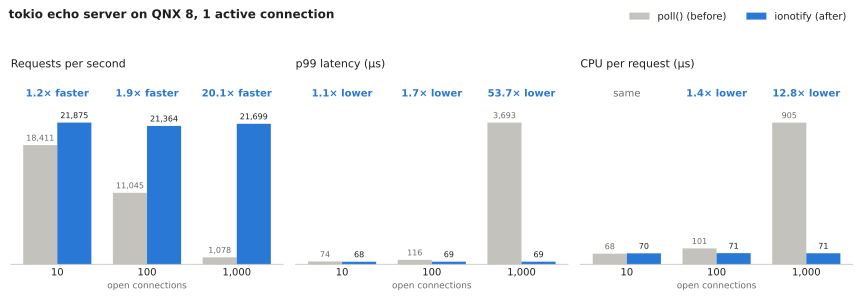
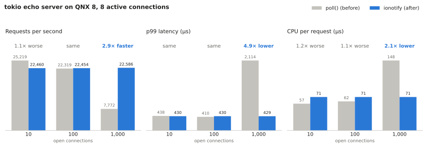

# qnx-async-rust

A native QNX 8 event backend for [mio](https://github.com/tokio-rs/mio) (and so
for tokio and the rest of async Rust), built on `ionotify()` and pulses instead
of `poll()`. This repository holds the evidence and tooling around it: the
go/no-go prototype, the benchmark, the stress test and the QNX test runner.

|                             |                                                                                                                                                                                                                                  |
| --------------------------- | -------------------------------------------------------------------------------------------------------------------------------------------------------------------------------------------------------------------------------- |
| Upstream                    | https://github.com/tokio-rs/mio                                                                                                                                                                                                  |
| Issue                       | [tokio-rs/mio#1902](https://github.com/tokio-rs/mio/issues/1902): QNX: add an `ionotify()`-based event driver                                                                                                                    |
| `target_os = "qnx"` support | [tokio-rs/mio#2053](https://github.com/tokio-rs/mio/pull/2053)                                                                                                                                                                   |
| ionotify selector           | [tokio-rs/mio#2056](https://github.com/tokio-rs/mio/pull/2056)                                                                                                                                                                   |
| libc bindings               | [rust-lang/libc#5783](https://github.com/rust-lang/libc/pull/5783): `ionotify()`, `_NOTIFY_*`, `SIGEV_PULSE`, `struct _pulse`, `RLIMIT_SIGEVENT_NP` (issue [rust-lang/libc#5780](https://github.com/rust-lang/libc/issues/5780)) |
| libc-test on QNX 8          | [rust-lang/libc#5785](https://github.com/rust-lang/libc/issues/5785): ctest does not run for `target_os = "qnx"`                                                                                                                 |

## The problem

On QNX, mio falls back to its `poll()` selector. QNX's `poll()` is itself built
on `ionotify()`: every call asks the resource manager (`io-sock` for sockets)
about **every** registered fd, then disarms them all again. The cost of each
wakeup therefore grows with the number of open connections, idle ones included.

## What the selector does

- One private channel per `Poll`, plus a side-channel connection to it.
- Each registered fd gets a pulse event (`MsgRegisterEvent`) whose value is its
  slot index, armed with `ionotify(_NOTIFY_ACTION_POLLARM)`. The resource
  manager sends the pulse when the fd becomes ready.
- `select` waits in `MsgReceivePulse`, so a wakeup costs the same however many
  fds are registered.
- `Waker` is a pulse on the same channel: no pipe.
- Hang-ups and errors: `ionotify()` can't report them, so one zero-timeout
  `poll()` runs over **only the fds that just pulsed**, before they are armed
  again.

## Results

Two echo servers on a QNX 8.0 x86_64 VM, each built twice from the same mio
commit: once on mio's `poll()` selector, once on ionotify. The **mio** server
uses mio directly; the **tokio** server is a single-threaded tokio runtime
with one task per connection. N connections are open and K of them run a
closed-loop 64-byte ping-pong; the rest stay idle. The client uses std only and
is the same for every server. CPU counts the server **and `io-sock`**, because
QNX's `poll()` does much of its work there. Every number is the median of 3
runs; runs differ by about ±2%.

### At a glance: 10 → 1000 open connections

| Server, K active | Selector | Requests/s       | p99 latency       | CPU per request |
| ---------------- | -------- | ---------------- | ----------------- | --------------- |
| mio, 1           | poll     | 12.6k → 1.3k     | 168 → 3,490 µs    | 79 → 770 µs     |
|                  | ionotify | **14.0k → 14.0k** | **152 → 152 µs**  | **77 → 77 µs**  |
| mio, 8           | poll     | 24.1k → 7.7k     | 618 → 1,902 µs    | 59 → 150 µs     |
|                  | ionotify | **27.9k → 28.0k** | **364 → 360 µs**  | **63 → 63 µs**  |
| tokio, 1         | poll     | 18.4k → 1.1k     | 74 → 3,693 µs     | 68 → 905 µs     |
|                  | ionotify | **21.9k → 21.7k** | **68 → 69 µs**    | **70 → 71 µs**  |
| tokio, 8         | poll     | 25.2k → 7.8k     | 438 → 2,114 µs    | 57 → 148 µs     |
|                  | ionotify | **22.5k → 22.6k** | **430 → 429 µs**  | **71 → 71 µs**  |

- **ionotify stays flat; `poll()` does not.** Going from 10 to 1000 open
  connections, `poll()` loses 3–17× throughput and its p99 grows 3–50×. With
  ionotify every column stays within 2%, for mio and for tokio.
- **At 1000 connections and one active**, tokio on ionotify serves **20×** the
  requests of tokio on `poll()`, with **53×** lower p99 and **13×** less CPU
  per request.
- **Where ionotify loses:** tokio with 8 active and only 10 open connections
  runs about 10% slower on ionotify (22.5k vs 25.2k req/s) and uses more CPU
  per request (71 vs 57 µs). tokio registers every socket for writing as well
  as reading. After a read returns `WouldBlock`, mio re-registers the full
  interest (`IoSourceState::do_io`), and an idle socket is still writable, so
  it is reported writable again: an extra pulse, `poll()` and `ionotify()`
  calls per request. The cost is per request and doesn't grow with connection
  count. The same re-registration path drives mio's `poll()` and Solaris
  selectors.

### Charts

The label above each pair is ionotify's change against `poll()`; "same" means
within 5%.









### Caveats

- One VM (QEMU, 4 vCPUs, 2 GiB), with client and server sharing it over
  loopback. The ratios are the result; the absolute numbers say little about
  real hardware, and they shift between VM sessions, so only compare numbers
  from the same run.
- The tokio server builds against tokio 1.54.1 with `target_os = "qnx"` added
  ([`patches/`](patches)) and socket2 from git, because no release of either
  supports the QNX 8 targets yet.

Raw data: [`bench/results/20261126-151202.csv`](bench/results/20261126-151202.csv),
setup: [`bench/results/20261126-151202-setup.txt`](bench/results/20261126-151202-setup.txt).

## Correctness

- **mio's test suite** passes on the QNX 8 VM with the ionotify selector and,
  with `--cfg mio_unsupported_force_poll_poll`, with the `poll()` selector. The
  one exception is the `pipe::new` doctest, which fails on both: QNX pipes
  report no `POLLHUP` when the writer closes.
- **Stress test** ([`stress/`](stress)): N TCP connections with echo threads; the
  mio side writes random bursts of a known byte pattern and checks every echoed
  byte, while another thread wakes the `Waker` at random. A connection with data
  in flight that makes no progress for 5 s fails the run as a lost wakeup.

  | Run (release)         | Echoed   | Events  | Waker events / wakes | Readable events with nothing to read | Result |
  | --------------------- | -------- | ------- | -------------------- | ------------------------------------ | ------ |
  | 10 s, 100 connections | 1.8 GiB  | 112 432 | 970 / 970            | 0                                    | pass   |
  | 60 s, 200 connections | 10.4 GiB | 698 576 | 5 757 / 5 757        | 0                                    | pass   |

- **Event limit**: each registration uses one registered event, capped by
  `RLIMIT_SIGEVENT_NP` (256 by default). Past it, `register` fails with
  `EAGAIN` and everything already registered keeps working (covered by mio's
  `tests/ionotify.rs`). Raise the limit for more than ~250 connections.

## Repository layout

```
ci/qnx-runner.sh          cargo runner: copy a binary to the target over SSH and run it
prototype/ionotify-proto  go/no-go checks of ionotify(), pulses and MsgRegisterEvent()
bench/                    mio and tokio echo servers, std load client, run.sh matrix, plot.py, results/
patches/                  tokio 1.54.1 with target_os = "qnx" support, used by bench/
stress/                   lost and duplicate wakeup stress test
```

## Reproducing

**Needs:** QNX SDP 8.0 on a Linux host, Rust nightly with `rust-src` (the QNX
targets are tier 3, so std is built with `-Z build-std`; each crate's
`.cargo/config.toml` sets this), and a QNX 8 x86_64 target reachable as
`ssh qnx` with root (to raise the fd and registered-event limits).

```sh
source ~/qnx800/qnxsdp-env.sh
export CARGO_TARGET_X86_64_PC_QNX_RUNNER=$PWD/ci/qnx-runner.sh

# Prototype checks (one by name, or all)
(cd prototype/ionotify-proto && cargo run -- hup_poll)

# Stress test: seconds, connections
(cd stress && cargo run --release -- 300 200)

# Benchmark matrix (RUNS, TOTALS, ACTIVES, WARMUP, MEASURE, SERVERS are tunable), then charts
(cd bench && ./run.sh && python3 plot.py results/<stamp>.csv)
```

`QNX_SSH_HOST` picks a different SSH host for `run.sh` and the runner.

`ALWAYS_WRITABLE=1` in the mio server's environment registers every connection
for reading and writing, as tokio does, instead of reading only. Comparing the
two isolates the read+write re-registration cost described under Results.
