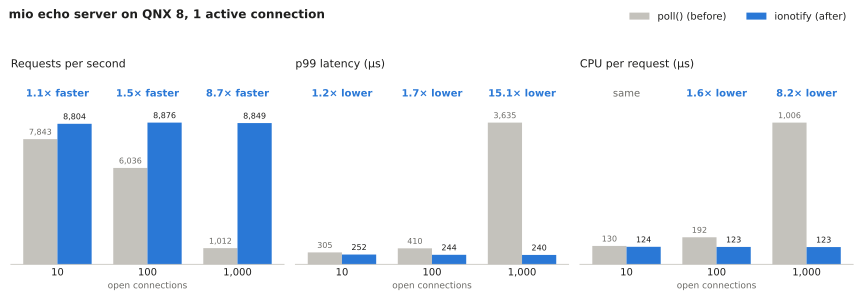
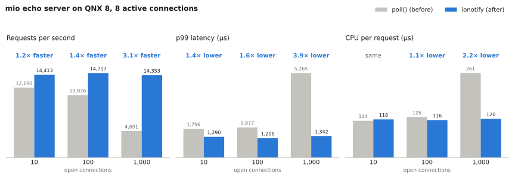

# qnx-async-rust

A native QNX 8 event backend for [mio](https://github.com/tokio-rs/mio) (and so
for tokio and the rest of async Rust), built on `ionotify()` and pulses instead
of `poll()`. This repository holds the evidence and tooling around it: the
go/no-go prototype, the benchmark, the stress test and the QNX test runner.

| | |
|---|---|
| Upstream | https://github.com/tokio-rs/mio |
| Issue | [tokio-rs/mio#1902](https://github.com/tokio-rs/mio/issues/1902): QNX: add an `ionotify()`-based event driver |
| `target_os = "qnx"` support | [tokio-rs/mio#2053](https://github.com/tokio-rs/mio/pull/2053) |
| ionotify selector | branch [`qnx-ionotify`](https://github.com/psychopunksage/mio/tree/qnx-ionotify) |

## The problem

On QNX, mio falls back to its `poll()` selector. QNX's `poll()` is itself built
on `ionotify()`: every call asks the resource manager (`io-sock` for sockets)
about **every** registered fd, then disarms them all again. The cost of each
wakeup therefore grows with the number of open connections, idle ones included.

## What the selector does

- One private channel per `Poll`, plus a side-channel connection to it.
- Each registered fd gets a pulse event (`MsgRegisterEvent`) whose value is its
  slot index, armed with `ionotify(_NOTIFY_ACTION_POLLARM)`. The resource
  manager sends the pulse when the fd becomes ready.
- `select` waits in `MsgReceivePulse`, so a wakeup costs the same however many
  fds are registered.
- `Waker` is a pulse on the same channel: no pipe.
- Hang-ups and errors: `ionotify()` can't report them, so one zero-timeout
  `poll()` runs over **only the fds that just pulsed**, before they are armed
  again.

## Results

mio echo server on a QNX 8.0 x86_64 VM: N connections open, K of them running a
closed-loop 64-byte ping-pong and the rest idle. The same server is built twice
from the same mio commit, once on the `poll()` selector and once on ionotify;
the client uses std only and is identical for both. CPU counts the server **and
`io-sock`**, because QNX's `poll()` does much of its work there. Bars are the
median of 3 runs (most cells vary by about ±2%); the label above each pair is
ionotify's improvement over `poll()`, and "same" means within 5%.





**1 active connection**

| Open connections | Selector | req/s | p50 µs | p99 µs | CPU µs/req |
|---|---|---|---|---|---|
| 10 | poll | 7 843 | 110.5 | 304.8 | 130.3 |
| 10 | ionotify | 8 804 | 101.1 | 251.6 | 124.1 |
| 100 | poll | 6 036 | 143.1 | 409.6 | 191.9 |
| 100 | ionotify | 8 876 | 101.6 | 244.1 | 123.4 |
| 1000 | poll | 1 012 | 782.1 | 3 634.6 | 1 005.8 |
| 1000 | ionotify | **8 849** | **101.6** | **240.5** | **122.6** |

**8 active connections**

| Open connections | Selector | req/s | p50 µs | p99 µs | CPU µs/req |
|---|---|---|---|---|---|
| 10 | poll | 12 190 | 582.1 | 1 795.8 | 113.6 |
| 10 | ionotify | 14 413 | 524.7 | 1 289.8 | 117.8 |
| 100 | poll | 10 876 | 699.3 | 1 877.3 | 125.1 |
| 100 | ionotify | 14 717 | 521.1 | 1 206.4 | 115.9 |
| 1000 | poll | 4 601 | 1 495.4 | 5 265.3 | 261.0 |
| 1000 | ionotify | **14 353** | **539.6** | **1 342.0** | **119.6** |

- **ionotify stays flat as connections grow; `poll()` does not.** With 1000
  open connections and one active: 8.7× the throughput, 15× lower p99 and 8.2×
  less CPU per request. With 8 active: 3.1×, 3.9× and 2.2×.
- **With few connections the gain is small:** +12% (K=1) and +18% (K=8)
  throughput at 10 connections. At 10 connections and K=8, `poll()` used
  slightly less CPU per request (113.6 vs 117.8 µs).
- **Caveats:** one VM (QEMU, 4 vCPUs, 2 GiB), with client and server sharing it
  over loopback. The ratios are the result; the absolute numbers say little
  about real hardware. Raw mio, not tokio.

Raw data: [`bench/results/20261124-162054.csv`](bench/results/20261124-162054.csv),
setup: [`bench/results/20261124-162054-setup.txt`](bench/results/20261124-162054-setup.txt).

## Correctness

- **mio's test suite** passes on the QNX 8 VM with the ionotify selector and,
  with `--cfg mio_unsupported_force_poll_poll`, with the `poll()` selector. The
  one exception is the `pipe::new` doctest, which fails on both: QNX pipes
  report no `POLLHUP` when the writer closes.
- **Stress test** ([`stress/`](stress)): N TCP connections with echo threads; the
  mio side writes random bursts of a known byte pattern and checks every echoed
  byte, while another thread wakes the `Waker` at random. A connection with data
  in flight that makes no progress for 5 s fails the run as a lost wakeup.

  | Run (release) | Echoed | Events | Waker events / wakes | Readable events with nothing to read | Result |
  |---|---|---|---|---|---|
  | 10 s, 100 connections | 1.8 GiB | 112 432 | 970 / 970 | 0 | pass |
  | 60 s, 200 connections | 10.4 GiB | 698 576 | 5 757 / 5 757 | 0 | pass |

- **Event limit**: each registration uses one registered event, capped by
  `RLIMIT_SIGEVENT_NP` (256 by default). Past it, `register` fails with
  `EAGAIN` and everything already registered keeps working (covered by mio's
  `tests/ionotify.rs`). Raise the limit for more than ~250 connections.

## Repository layout

```
ci/qnx-runner.sh          cargo runner: copy a binary to the target over SSH and run it
prototype/ionotify-proto  go/no-go checks of ionotify(), pulses and MsgRegisterEvent()
bench/                    echo server, std load client, run.sh matrix, plot.py, results/
stress/                   lost and duplicate wakeup stress test
```

## Reproducing

**Needs:** QNX SDP 8.0 on a Linux host, Rust nightly with `rust-src` (the QNX
targets are tier 3, so std is built with `-Z build-std`; each crate's
`.cargo/config.toml` sets this), and a QNX 8 x86_64 target reachable as
`ssh qnx` with root (to raise the fd and registered-event limits).

```sh
source ~/qnx800/qnxsdp-env.sh
export CARGO_TARGET_X86_64_PC_QNX_RUNNER=$PWD/ci/qnx-runner.sh

# Prototype checks (one by name, or all)
(cd prototype/ionotify-proto && cargo run -- hup_poll)

# Stress test: seconds, connections
(cd stress && cargo run --release -- 300 200)

# Benchmark matrix (RUNS, TOTALS, ACTIVES, WARMUP, MEASURE are tunable), then charts
(cd bench && ./run.sh && python3 plot.py results/<stamp>.csv)
```

`QNX_SSH_HOST` picks a different SSH host for `run.sh` and the runner.
